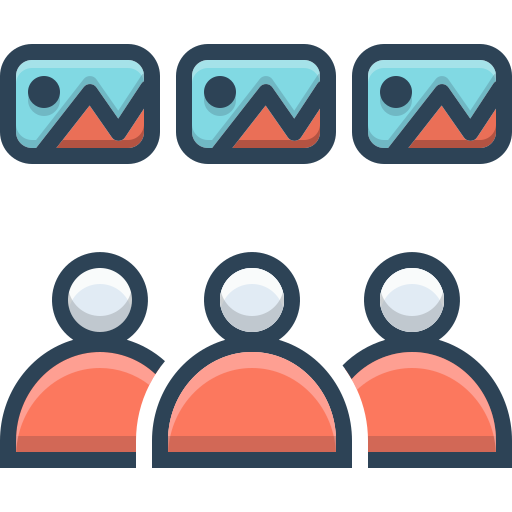

<p align="center"></p>

<h1 align="center">PhotoPresenter</h1>

<p align="center"><a href="README.md">English</a> · <b>Deutsch</b></p>

<p align="center"></p>

Zufällige Vollbild-Foto-Diashow für Windows und Linux.

**Loslegen mit einem Weitergabe-Ordner:** [Quickstart.md](Quickstart.md) (auch als [PDF](Quickstart.pdf)).
Fertige Windows-Programme gibt es unter [Releases](https://github.com/RealCommerzpunk/PhotoPresenter/releases).

- Fotos aus einem Ordner in zufälliger Reihenfolge, möglichst bildschirmfüllend.
  Freie Ränder werden unauffällig aus dem Foto selbst aufgefüllt.
- Lebendige Bewegung: Zoom, Schwenk, Kamerafahrten (Ken Burns).
- Konfigurierbare Übergänge. Anzeigedauer, Bewegungsintensität, Überblenddauer und Effekte
  sind jeweils als Bereich „von … bis“ einstellbar, fest oder zufällig.
- **Fokus-Person**: Eine angelernte Person wird in den Fotos erkannt und angezoomt,
  optional mit einem Schwenk über die anderen Gesichter.
- **Texte**: Fülltexte zwischen den Fotos und an Fotos gebundene Texte (vor, nach oder über dem Bild),
  mit frei wählbaren oder zufälligen Stilen und Animationen. Texte und Emojis verdecken keine Gesichter.
- **3D-Fotowelt**, Partikel-Effekte, **Handy-Fernbedienung** per QR-Code und eine **portable Version** zum Mitnehmen.

> Status: in Entwicklung. Der Fahrplan steht unten.

## Entwicklung

Voraussetzung: Node.js ≥ 22.12.

```bash
npm install
npm run models       # Modelle für die Gesichtserkennung laden (einmalig, ca. 39 MB)
npm run dev          # App mit Hot Reload starten (erster Start nimmt die Demo-Fotos aus Photos/)
npm run dev -- --show  # direkt die Diashow starten
npm test             # Unit-Tests (Vitest)
npm run typecheck
npm run lint
```

Installer bauen (nur lokal, GitHub speichert nur den Code):

```bash
npm run dist:win     # Windows: NSIS-Installer in dist/
npm run dist:linux   # Linux: AppImage und .deb in dist/ (auf einem Linux-Rechner oder in WSL ausführen)
```

Testläufe mit eigenem Datenordner (lässt die echten Einstellungen in Ruhe): `PP_USER_DATA=<ordner>`. Frame-Messung: `PP_PERF=1`.

Für Tests ohne Hinsehen: Ist `PP_CAPTURE_DIR` gesetzt, speichert die App im Entwicklungsmodus
alle 2 s ein Bild ihrer eigenen Fenster in diesen Ordner.

Tests, Typprüfung und Lint vor jedem Commit lokal ausführen: `npm run typecheck && npm run lint && npm test`.

> Hinweis: Ist in der Shell `ELECTRON_RUN_AS_NODE=1` gesetzt (manche Editor-Umgebungen tun das),
> startet Electron als reines Node und die App bricht mit `Cannot read properties of undefined (reading 'whenReady')` ab.
> Dann die Variable vorher entfernen.

## Bedienung in der Show

Esc beenden · Leertaste Pause · ←/→ blättern · I Info zum Foto (Auflösung, Zoom, EXIF) · R Fernbedienung als Fenster · Q QR-Code · D fps

## Mitnehmen

Die portable Version (`PhotoPresenter <version>.exe` aus `npm run dist:win`, unter Linux das AppImage) speichert alles im Ordner `Data` neben der Programmdatei. Mit einem Ordner `Photos` daneben und dem Fotoordner „Photos“ in den Einstellungen lässt sich der ganze Ordner kopieren und weitergeben. Einfacher: **Einstellungen → Allgemein → Mitnehmen → Paket für die Weitergabe erstellen**.

Die Anleitung `Quickstart.md` ist die Quelle für `Quickstart.pdf` (liegt jedem Weitergabe-Paket bei); nach Änderungen `npm run quickstart` ausführen.

## Aufbau

```
src/main/       Electron-Main-Prozess: Fenster, IPC, Einstellungen, Datenbank
src/preload/    sichere Brücke zwischen Main und Fenstern (window.api)
src/shared/     gemeinsamer Code (Typen, Zufalls-/Range-Logik)
src/renderer/settings/  Einstellungsfenster (React + Tailwind)
src/renderer/show/      Vollbild-Diashow (PixiJS/WebGL)
resources/      Modelle und Fonts, die mit ausgeliefert werden
```

## Fahrplan

1. ✅ Gerüst und Repo
2. ✅ Basis-Diashow: Ordner, zufällige Playlist, Auffüllen der Ränder, Ken Burns, Überblenden
3. ✅ Einstellungsfenster und Konfigurationsmodell
4. ✅ Übergangs-Bibliothek, weitere Füllmodi, Kamerafahrten
5. ✅ Texte: Editor, Stile, Animationen
6. ✅ Gesichtserkennung und Fokus-Person
7. Feinschliff und erstes Release (Ruckelfreiheit erledigt in 0.6.2)

Dazugekommen (0.7–0.12): Mitnehmen (portabel, Weitergabe-Paket), Bildschirmauswahl, Fernbedienung per Handy mit QR-Code (mit Emojis, Einfrieren, Galerie und eigener Reihenfolge), Fokus-Partner, Zoomgrenze und Begrenzung kleiner Fotos, relativer Fotopfad und portable Windows-Version, Partikel-Effekte, animierte Textfolien-Hintergründe, 3D-Fotowelt (inkl. Wackelpudding-Würfel).

## Datenschutz und Sicherheit

Alles läuft offline auf dem eigenen Rechner. Die Handy-Fernbedienung ist ein kleiner Webserver im lokalen Netz
**ohne Passwort**: Jeder im selben Netz kann die Show steuern. In fremden Netzen unter
**Allgemein → Fernbedienung** ausschalten.

## Lizenz und Danksagung

Der **Quellcode** steht unter der [MIT-Lizenz](LICENSE). Mitgelieferte Inhalte behalten ihre eigene Lizenz:

- **Demo-Fotos** in [`Photos/`](Photos/): [RDNE Stock project](https://www.pexels.com/@rdne/) auf Pexels,
  [Pexels-Lizenz](https://www.pexels.com/license/), nicht MIT – siehe [Photos/CREDITS.md](Photos/CREDITS.md).
- **Programm-Icon:** [Three Musketeers – Flaticon](https://www.flaticon.com/authors/three-musketeers).
- **Gesichtsmodelle** (per `npm run models`, nicht im Repo): YuNet (MIT) und SFace (Apache-2.0) aus dem
  [OpenCV Model Zoo](https://github.com/opencv/opencv_zoo).
- **Schriften** über Fontsource: SIL Open Font License. **GSAP**: Standard „No Charge“ License.
  Übrige npm-Pakete unter ihren eigenen (meist MIT-)Lizenzen.
